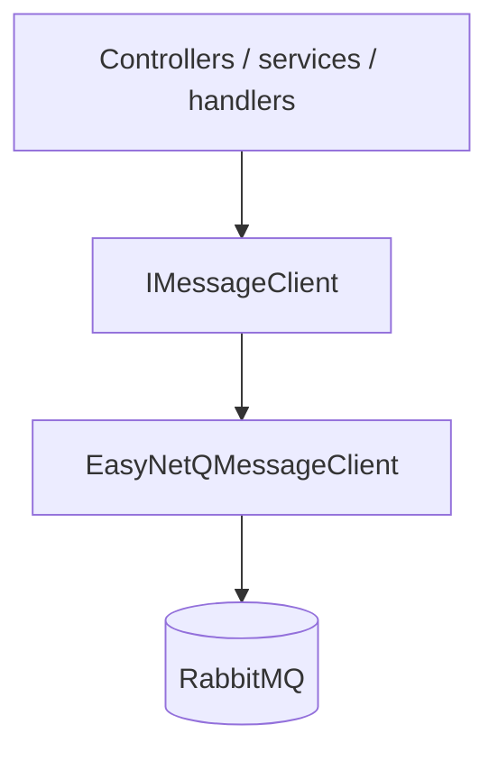

# Messaging

## Overview

ChannelManagement communicates with other parts of Bizcord through RabbitMQ.
It publishes events when channels change, handles incoming messages, and can
answer requests. The broker is hidden behind an interface so it can be replaced.
For setup, migrations and running tests, see the [README](../README.md).

## Architecture

| Component               | Responsibility                                                                                  |
| ----------------------- | ----------------------------------------------------------------------------------------------- |
| `IMessageClient`        | Interface: publish, subscribe, request/reply [CHECK: exact methods]                             |
| `EasyNetQMessageClient` | The only class that references EasyNetQ                                                         |
| `AddMessageClient`      | DI registration; reads `ConnectionStrings:RabbitMq`                                             |
| `Messaging/Events`      | Message classes, e.g. `ChannelCreated`, `MessagePostedEvent` [CHECK]                            |
| Message handler         | Handles `MessagePostedEvent`: increments `Channels.newMessageCount` and publishes [CHECK: what] |
| `ChannelQueryResponder` | Answers `ChannelsAndCategoriesRequest` [CHECK: still present?]                                  |

## Messages

Describe each message: who sends it, who receives it, and its fields.
[CHECK: copy field lists from the records]

## Design decisions

- **Interface over EasyNetQ.** The assignment requires that the broker can be
  swapped. The interface only uses concepts all brokers share (publish,
  subscribe, request/reply) and no RabbitMQ terms such as exchanges or routing
  keys, so a Kafka adapter could implement it.
- **Message classes, not EF entities.** Entities have navigation properties that
  can cause serialization loops and would tie consumers to the database schema.
- **Serialization by EasyNetQ.** Messages are serialized by the serializer
  registered in `AddMessageClient`; contract tests pin the JSON field names.
  [CHECK: is JsonMessageSerializer still in the code? If not, drop it.]
- **Scope per message in handlers.** `DbContext` is scoped to an HTTP request;
  handlers run outside one, so each message gets its own scope.

## Testing

- Message contract tests (`MessagePostedContractTests`) and the handler test
  are described in the README, sections "Message contract tests" and
  "Message-count migration and handler test".
- These are local tests: they don't verify real broker delivery.

## Known limitations

- [CHECK: fill in what is actually true, e.g. no filtering of channels by user]
