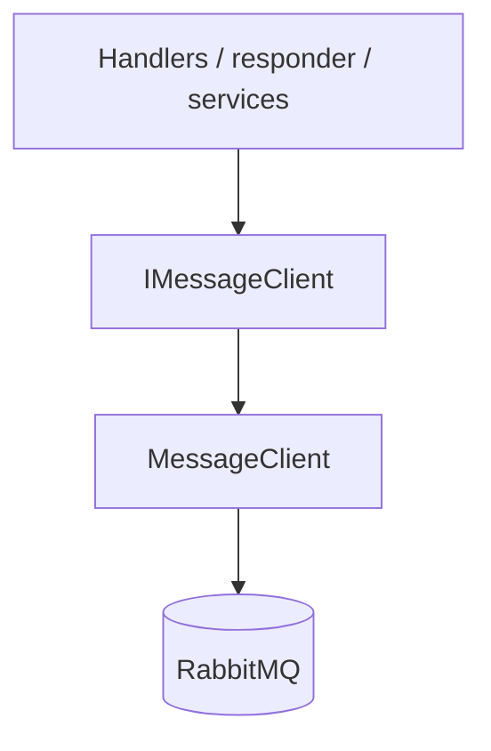

# Messaging

## Overview

ChannelManagement communicates with other parts of Bizcord through RabbitMQ.
The messaging layer can publish and subscribe to events and send or answer
requests. The broker is hidden behind an interface so it can be replaced.
For setup, migrations and running tests, see the [README](../README.md).

This document describes the current state of the messaging layer, which is
still under development. See "Status and next steps" at the end.

## Architecture

| Component                   | Responsibility                                                                                                 |
| --------------------------- | -------------------------------------------------------------------------------------------------------------- |
| `IMessageClient`            | Interface with `PublishAsync`, `SubscribeAsync`, `RequestAsync` and `RespondAsync`                             |
| `MessageClient`             | Implements the interface with EasyNetQ; the only class that references EasyNetQ                                |
| `AddMessageClient`          | DI registration: adds EasyNetQ with `ConnectionStrings:RabbitMq` and registers `IMessageClient` as a singleton |
| `IMessageHandler<TMessage>` | Interface for handlers: one `Handle(message, cancellationToken)` method                                        |
| `MessagePostedHandler`      | Handles `MessagePostedEvent`                                                                                   |
| `ChannelQueryResponder`     | Background service that answers `ChannelsAndCategoriesRequest`                                                 |
| `JsonMessageSerializer`     | Small System.Text.Json helper (camelCase)                                                                      |

## Messages

Events are in `Messaging/Events`, request/reply types in `Messaging/Requests`,
and `MessagePostedEvent` in `Shared`.

| Message                            | Fields                                                                                                                                             |
| ---------------------------------- | -------------------------------------------------------------------------------------------------------------------------------------------------- |
| `ChannelCreated`, `ChannelUpdated` | `ChannelId`, `ServerId`, `Title`, `Description`, `Categories`, `Type`, `UserRoles`, `WriteRights`, `Visibility`                                    |
| `ChannelDeleted`                   | `ChannelId`, `ServerId`                                                                                                                            |
| `MessagePostedEvent`               | `MessageId`, `ChannelId`, `AuthorId`, `Content`, `PostedAt`, `ProcessedAt`                                                                         |
| `ChannelsAndCategoriesRequest`     | `ServerId`                                                                                                                                         |
| `ChannelsAndCategoriesReply`       | `ServerId`, `Categories`: list of `CategoryDto` (`Name`, `Channels`: list of `ChannelDto` with `Id`, `Title`, `Description`, `Type`, `Visibility`) |

`ChannelUpdated` carries the full state of the channel, so a listener can
overwrite what it knows without tracking which field changed.

## How it works

**Publishing and subscribing.** `PublishAsync(message)` serializes the message
to JSON and EasyNetQ routes it by message type to every subscriber.
`SubscribeAsync<T>(subscriptionId, handler)` registers a handler; subscribers
with different IDs each receive every message.

**Message handler.** `MessagePostedHandler` looks up the channel by `ChannelId`,
increments `Channels.newMessageCount`, saves, and publishes a
`MessagePostedEvent` with `ProcessedAt` set and the original `MessageId` kept
for traceability. If the channel does not exist, it throws.

**Request/reply.** A caller sends `ChannelsAndCategoriesRequest(serverId)` with
`RequestAsync` and waits for the reply. The responder is a hosted service that
registers with the broker at startup. For each request it queries the channels
of the server and groups them by their category string.

## Design decisions

- **Interface over EasyNetQ.** The assignment requires that the broker can be
  swapped. The interface only uses concepts all brokers share (publish,
  subscribe, request/reply) and no RabbitMQ terms such as exchanges or routing
  keys, so a Kafka adapter could implement it.
- **Message classes, not EF entities.** Entities have navigation properties that
  can cause serialization loops and would tie consumers to the database schema.
- **Scope per request in the responder.** `DbContext` is scoped to an HTTP
  request, and the responder runs outside one, so it creates a scope for each
  incoming request through `IServiceScopeFactory`.
- **Singleton client.** One broker connection is shared by the whole application.

## Testing

- The `MessagePostedEvent` contract cases and the handler test live in
  `tests/UnitTests`; see the README sections "Message contract tests" and
  "Message-count migration and handler test".
- They use the serializer alone or a mocked client, so they do not verify real
  broker delivery.
- The request/reply path was verified manually: a request travelled through
  RabbitMQ, the responder queried SQL Server, and the reply came back.

## Status and next steps

This is a work in progress. Known open items:

- Subscribing `MessagePostedHandler` to the broker at startup. Since it
  republishes the same message type it consumes, the result may need its own
  type to avoid receiving its own output.
- Publishing `ChannelCreated`, `ChannelUpdated` and `ChannelDeleted` from the
  CRUD service.
- Deciding whether `JsonMessageSerializer` is used or removed; EasyNetQ's own
  serializer currently handles all messages.
- Replacing `Visibility` with role- or user-based access rules, and filtering the
  channel reply by the requesting user. This also changes the request.
- Categories are currently a plain string on the channel; a separate category
  entity may follow.
